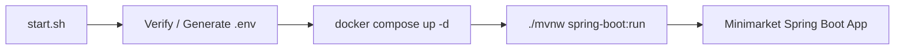

# Requirements

### Overview & Goals
Provide a streamlined, single-command startup solution (`start.sh`) that boots the Minimarket project and its dependencies with minimal overhead. The goal is to maximize developer efficiency and system readiness by automating environment file preparation, Docker service startup, and application execution.

### Scope
- **In Scope**:
  - Creation of a lightweight `start.sh` shell script in the project root.
  - Automatic generation or validation of the required `.env` file containing Elasticsearch connection parameters and secure JWT secrets.
  - Startup of required background containers via `docker compose up -d`.
  - Execution of the Spring Boot application using `./mvnw spring-boot:run`.
- **Out of Scope**:
  - Heavy orchestration tools, multi-stage external daemon managers, or unnecessary wrapper abstractions.

### User Stories
- As a developer, I want to run a single command `./start.sh` so that all background services and the backend application start immediately without manual prerequisite configuration.

### Functional Requirements
- **FR-1**: If `.env` is missing, generate it with functional default values matching `application.properties` and `docker-compose.yml`.
- **FR-2**: Ensure JWT secrets satisfy the 256-bit requirement for HMAC-SHA signing in `JwtService`.
- **FR-3**: Run `docker compose up -d` to ensure Elasticsearch is running on port 9400.
- **FR-4**: Execute `./mvnw spring-boot:run` to start the Spring Boot service.

# Technical Design

### Current Implementation
- `src/main/resources/application.properties` expects:
  - `.env` import (`spring.config.import=file:.env[.properties]`).
  - Elasticsearch config: `ES_URI`, `ES_USERNAME`, `ES_PASSWORD`.
  - JWT secret config: `ACCESS_TOKEN_SECRET`, `REFRESH_TOKEN_SECRET`.
  - MySQL database on `localhost:3306/minimarket`.
- `docker-compose.yml` configures Elasticsearch (`elasticsearch:9.2.4`) on port `9400:9200` with `ELASTIC_PASSWORD=${ES_PASSWORD:-changeme}`.
- Maven wrapper `./mvnw` is present in the project root.

### Key Decisions
- **Single concise script**: Use a clean, direct POSIX-compliant Bash script (`start.sh`) rather than complex multi-file tooling to optimize maintainability and execution speed.
- **Automated `.env` provisioning**: Create `.env` on first launch if missing, ensuring seamless out-of-the-box startup without requiring manual copy-pasting.

### File Structure
- `start.sh` (new) — Root entry point script.
- `.env` / `.env.example` (new) — Environment variables for local development.

### Architecture Diagram

# Testing

### Validation Approach
Verify that the startup flow is fully automated, syntax-valid, and correctly coordinates environment setup and service startup.

### Key Scenarios
- **Fresh start**: Running `start.sh` when `.env` is absent automatically initializes `.env` with required parameters and proceeds to start services.
- **Existing environment**: Running `start.sh` with an existing `.env` preserves current user configurations.
- **Syntax validation**: Confirm script passes `bash -n start.sh` with no syntax errors and possesses execute permissions (`+x`).

# Delivery Steps

### ✓ Step 1: Configure environment variables template and defaults
Establish default environment configuration required for the application to function without manual intervention.

- Create `.env` (and `.env.example`) containing required defaults: `ES_URI=http://localhost:9400`, `ES_USERNAME=elastic`, `ES_PASSWORD=changeme`, and valid 256-bit secret keys for `ACCESS_TOKEN_SECRET` and `REFRESH_TOKEN_SECRET`.
- Ensure compatibility with `application.properties` property loader (`spring.config.import=file:.env[.properties]`) and `docker-compose.yml`.

### ✓ Step 2: Create executable startup script
A functional and straightforward startup script is ready to boot all dependencies and the application.

- Create `start.sh` in the project root with executable permissions (`chmod +x`).
- In `start.sh`, verify/create the `.env` file if not already present.
- Start the required infrastructure services with `docker compose up -d`.
- Launch the Spring Boot application using `./mvnw spring-boot:run`.
- Verify script syntax and execution readiness.